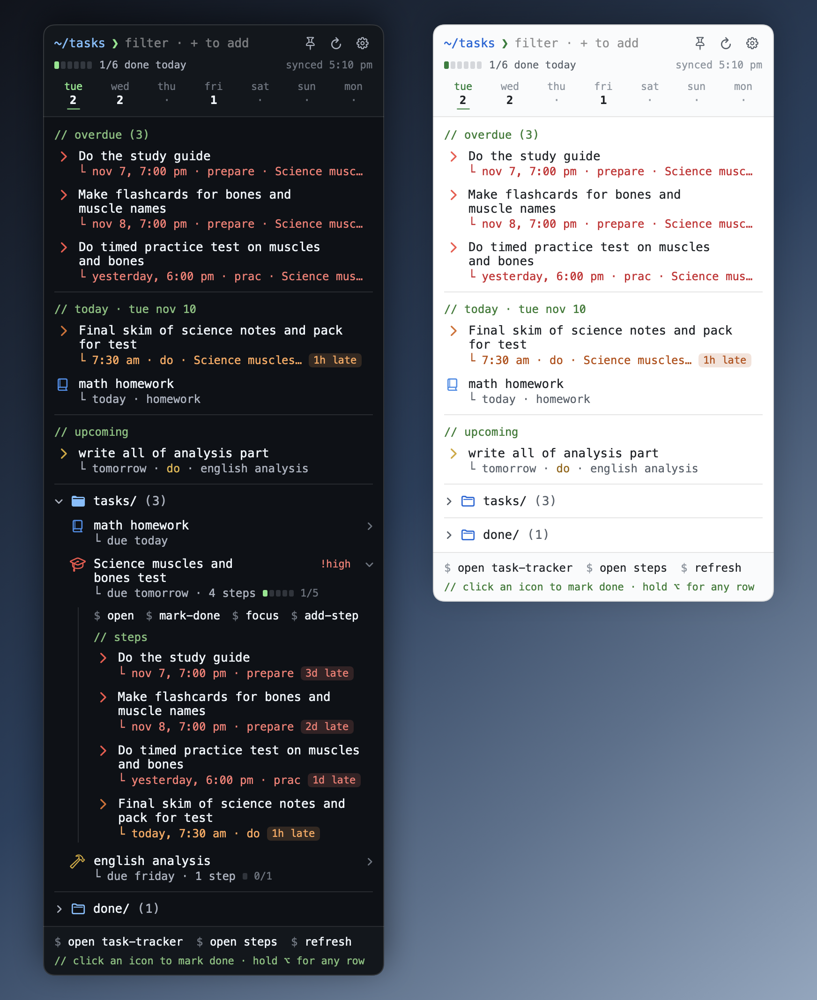
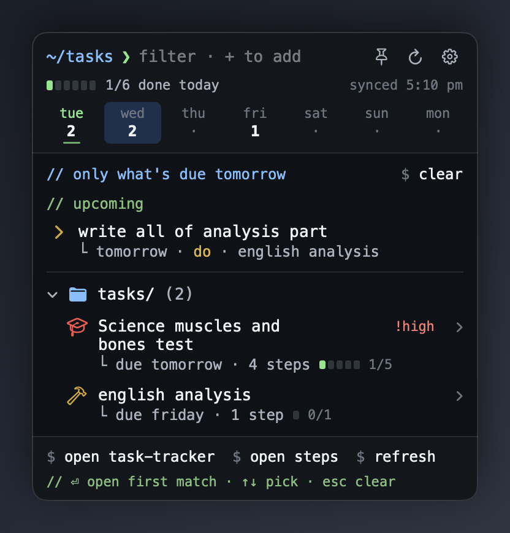
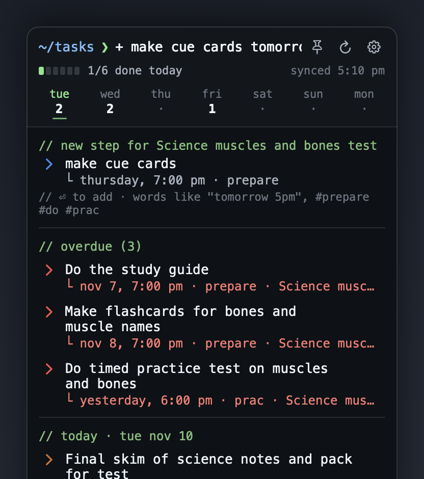
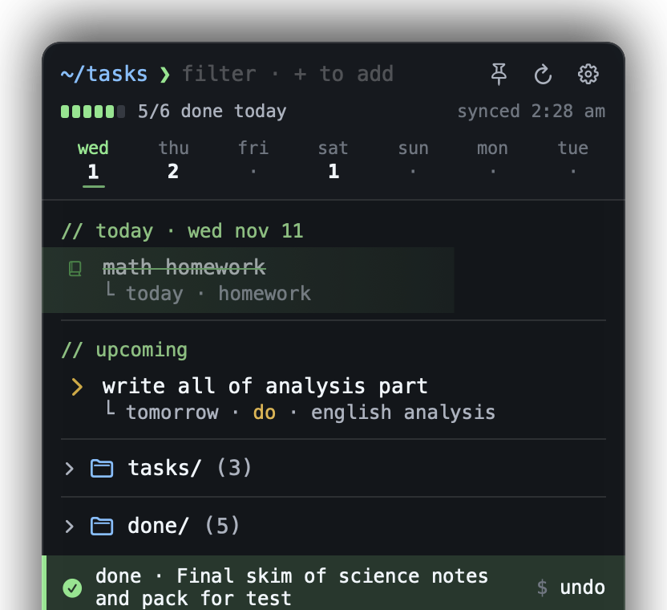
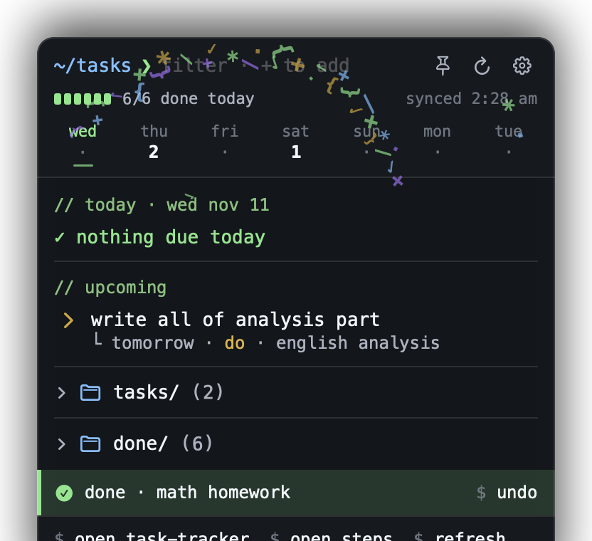
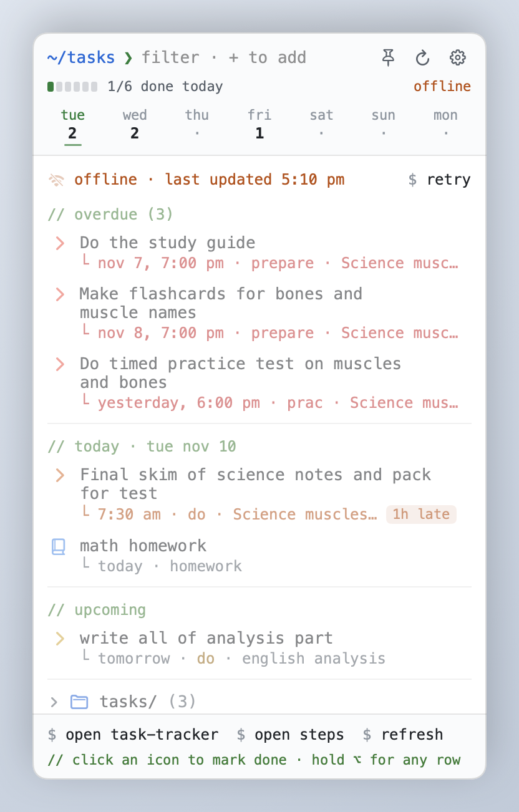
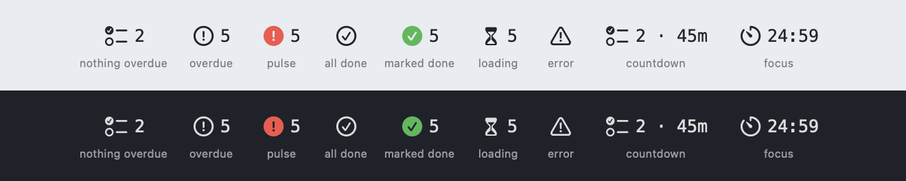
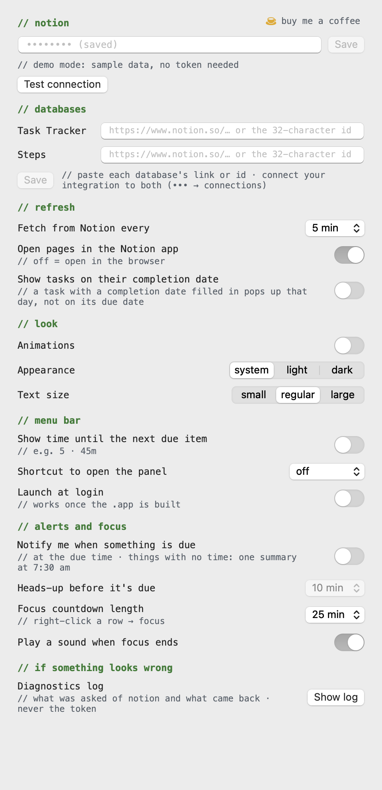

<h1 align="center">NotionBar</h1>

<p align="center">
  <b>Your Notion tasks and steps, one click away in the Mac menu bar.</b><br>
  A small native SwiftUI app with a code-editor look. No Electron, no dependencies, nothing between you and your own Notion.
</p>

<p align="center">
  
  
  
  
  <a href="LICENSE"></a>
  <a href="https://github.com/cyrus514/NotionBar/releases/latest"></a>
  <a href="https://buymeacoffee.com/cyrus_514"></a>
</p>

<p align="center">
  
</p>

## What it is

NotionBar reads two Notion databases, a **Task Tracker** (tests, homework, projects) and a **Steps**
database (the *Prepare / Do / Prac* steps each task is broken into), and keeps what's unfinished
in your menu bar:

- the **count** of what's overdue or due today sits next to the icon;
- one click opens a **panel** grouped into `// overdue`, `// today`, `// upcoming` and `tasks/`;
- you tick things off, add new ones and move dates **without opening Notion**.

It began as a SwiftBar plugin and grew into its own app so that every pixel of the menu could be
its own: Menlo throughout, section headers written as `// comments`, actions written as
`$ commands`, and colours borrowed from a code editor.

## Highlights

<table>
<tr>
<td width="330"></td>
<td>

### The week at a glance
A strip across the top shows how much is due on each of the next seven days. Click a day to see
only that day. A progress bar counts what you've finished today.

Timed rows carry a small badge (`in 45m`, `2h late`, `3d late`), and high-priority tasks are marked `!high`.

</td>
</tr>
<tr>
<td></td>
<td>

### Type to add, type to filter
The prompt at the top filters as you type. Start with `+` to add instead:

```text
+ essay draft friday 5pm #project !high
```

Unfold a task and choose `$ add-step` to add a step to it, with a date in plain words and a type:

```text
+ make cue cards tomorrow 7pm #prepare
```

</td>
</tr>
<tr>
<td></td>
<td>

### Ticking things off feels good
Hover a row and click its checkbox, hold <kbd>⌥</kbd> and click anywhere on it, or press <kbd>⌘</kbd><kbd>⏎</kbd>.
The row gets a green sweep, like an added line in a diff, then slides away. Finishing a task
finishes its steps too.

Changed your mind? `$ undo` (or <kbd>⌘</kbd><kbd>Z</kbd>) puts everything back, steps included.

</td>
</tr>
<tr>
<td></td>
<td>

### A small celebration
Tick off the last thing that was due and the panel throws a handful of `✓ + * { }` in the air.
Every animation respects macOS **Reduce Motion** and can be switched off in Settings.

</td>
</tr>
<tr>
<td></td>
<td>

### Honest about what it knows
The last list is saved, shown instantly at launch, and greyed out with *offline · last updated…*
when Notion can't be reached. It refreshes by itself when the connection comes back.
A bad token or a database that isn't connected gets a plain message and a button that fixes it.

</td>
</tr>
</table>

### The menu bar icon

<p align="center"></p>

The icon tells you the state without opening anything: a checklist when nothing is overdue, an
exclamation mark when something is, a checkmark when you're clear. The number rolls when it
changes, pulses red three times after a refresh if anything is overdue, and a green check pops in
when you finish something. Hover it for a one-line summary; right-click for Refresh, Settings,
Launch at Login and Quit.

### And also

- **`done/`**: what you finished today, with `$ reopen`. It counts things finished in Notion itself.
- **Pin** (<kbd>⌘</kbd><kbd>P</kbd>): keep the panel open beside your work and tick as you go.
- **Focus countdown** on any row: the menu bar counts down, then offers to mark it done.
- **Move a due date** from the right-click menu, keeping its time of day.
- **Notifications** (optional): a heads-up before a timed item, one when it's due, and a 7:30 am summary for untimed ones.
- **Plan by completion date** (optional): if you fill in a task's Completion date ahead of time as the
  day you mean to do it, the task pops up that day instead of on its due date, and still says when it's due.
- **Global shortcut** (optional) to open the panel from anywhere, and an optional countdown to the next due item.
- **Light and dark**, three text sizes, launch at login.

## Install

### Download the app

1. Download `NotionBar-1.0.0.zip` from the [latest release](https://github.com/cyrus514/NotionBar/releases/latest) and unzip it.
2. Drag **NotionBar.app** into your Applications folder and open it.
3. The first time, macOS will refuse to open it, because the app isn't notarized by Apple (that needs a
   paid developer account). Open **System Settings → Privacy & Security**, scroll down to the message
   about NotionBar, and click **Open Anyway**. You only have to do this once.

It runs on macOS 14 or later, on Apple silicon and Intel Macs.

### Or build it yourself

You need macOS 14 or later and the Xcode Command Line Tools (`xcode-select --install`). Xcode itself is not required.

```bash
git clone https://github.com/cyrus514/NotionBar.git
cd NotionBar
./build.sh --install
```

That compiles the app, puts `NotionBar.app` in `/Applications` and launches it.
To build without installing, run `./build.sh` and drag `build/NotionBar.app` into `/Applications` yourself.

**Just want a look?** This runs it on bundled sample data, with a fake Notion in memory, so you can
click everything safely with no token:

```bash
./build.sh --demo
```

## Connect your Notion

1. **Make an integration** at <https://www.notion.so/profile/integrations> and copy its secret (the token).
2. **Connect it to your two databases:** open each one in Notion, then ••• → Connections → add your integration.
3. **Launch NotionBar.** The first time, Settings opens. Paste the token, paste each database's
   link (or id) under **databases**, and press **Test connection**.

The token is kept in your Keychain and the database ids in the app's preferences. Neither is ever
written to this repository or to the log.

<details>
<summary><b>What the two databases need</b></summary>

<br>

NotionBar looks for these property names. Anything else in your databases is ignored.

**Task Tracker** (tests, homework, projects)

| Property | Type | Notes |
|---|---|---|
| `Task name` | title | |
| `Status` | status | `Not started`, `In progress`, `Done` |
| `Due date` | date | date only, date and time, or a range |
| `Task type` | multi-select | `homework`, `test`, `project`, `personal` pick the icon |
| `Priority` | select | `High` shows as `!high` |
| `Completion date` | date | set to today when you mark a task done |
| `Steps` | relation | to the Steps database |

**Steps**

| Property | Type | Notes |
|---|---|---|
| `Name` | title | |
| `Status` | status | `Not started`, `In progress`, `Done` |
| `Due date` | date | usually date and time |
| `Step type` | select | `Prepare`, `Do`, `Prac` |
| `Test / Project` | relation | to its task in the Task Tracker |

</details>

## Using it

| Do this | To |
|---|---|
| Click the menu bar icon | open the panel |
| Right-click the icon | Refresh, Settings…, Launch at Login, Quit |
| Click a row | open it in Notion (the app, or your browser) |
| Hover a row, click the checkbox | mark it done |
| Hold <kbd>⌥</kbd> and click a row | mark it done (every row shows `[x]`) |
| Right-click a row | start it, move it to another day, focus on it, copy its link |
| Click a task under `tasks/` | unfold its steps, with `$ open` `$ mark-done` `$ focus` `$ add-step` |
| Click a day in the week strip | show only what's due that day |
| Click the pin | keep the panel open while you work in other apps |
| Type | filter the list |
| Type `+ …` then <kbd>⏎</kbd> | add a task |

**Keyboard:** <kbd>↑</kbd> <kbd>↓</kbd> pick a row · <kbd>⏎</kbd> open · <kbd>⌘</kbd><kbd>⏎</kbd> or <kbd>⌘</kbd><kbd>D</kbd> mark done ·
<kbd>→</kbd> <kbd>←</kbd> unfold / fold · <kbd>⌘</kbd><kbd>Z</kbd> undo · <kbd>⌘</kbd><kbd>R</kbd> refresh · <kbd>⌘</kbd><kbd>N</kbd> new task ·
<kbd>⌘</kbd><kbd>P</kbd> pin · <kbd>⌘</kbd><kbd>,</kbd> settings · <kbd>esc</kbd> clear the filter, then close.

<details>
<summary><b>Settings</b></summary>

<br>



Notion token (with **Test connection**) · your two databases · show tasks on their completion date ·
refresh interval · open pages in the Notion app or the browser · animations · appearance · text size ·
menu bar countdown · global shortcut · launch at login · notifications and how early · focus length · diagnostics log.

</details>

## How it's built

- **Swift and SwiftUI, no third-party code.** Networking is `URLSession`, parsing is `Codable`.
- **A status item hosting SwiftUI.** The menu bar icon is a real SwiftUI view inside the status bar
  button, which is what lets it roll numbers, pulse and pop.
- **A see-through panel.** The window is transparent and slightly larger than the card, so the card
  can grow, shrink and cast a shadow without the window ever resizing.
- **A fake Notion in memory.** `FakeNotion` answers the same requests as the real API from JSON
  fixtures. Demo mode, the tests and the screenshots in this README all run on it.
- **Optimistic writes with rollback.** A tick shows instantly; if Notion refuses, the row comes back with the reason.

```
Sources/NotionBar/
  App/        entry point, app delegate, menu bar item, panel window
  Model/      Day + date parsing, Item, Board (sections), TaskStore (state, fetch, mark done)
  Notion/     API client, response models, FakeNotion
  Services/   settings, Keychain token, quick add, hot key, notifications, focus timer, login item, log
  UI/         theme, panel, rows, status icon, settings window, previews
  Dev/        --selftest, --dump, --snapshot, the app icon, the scripted debug driver
  Resources/  JSON fixtures shaped like real Notion replies, AppIcon.icns
Support/Info.plist     LSUIElement = YES (menu bar only, no Dock icon)
scripts/               ui_test.sh, compare_with_plugin.py, make_fixtures.py, make_icon.sh
```

## Checking it works

```bash
swift build
.build/debug/NotionBar --selftest
scripts/ui_test.sh
python3 scripts/compare_with_plugin.py
.build/debug/NotionBar --snapshot panel.png --state tasks --dark
```

- `--selftest` runs about 200 checks on the date rules, the Notion requests, the store and the
  Keychain import, against the fixtures. Add `--network` for one real request to Notion with a made-up token.
- `ui_test.sh` sends real mouse clicks through the app on the sample data (folders, rows, checkboxes,
  undo, ⌥-click, every button, the keyboard, filter, quick add, error screens) and checks what happened.
  The panel stays off screen and unfocused while it runs, and nothing is sent to Notion.
- `compare_with_plugin.py` checks that rows land in the same sections, in the same order, as the
  original SwiftBar plugin did, using output saved from a build that matched it line for line.
- `--snapshot` draws any panel state to a PNG. It stands in for Xcode previews when Xcode isn't installed.

## If something looks wrong

Settings → **Show log** opens `~/Library/Logs/NotionBar.log`. It records each fetch (how many rows
came back, how long it took), each change sent to Notion, and any error Notion returned.
It never contains the token and doesn't record task names.

<details>
<summary><b>Good to know</b></summary>

<br>

- **Keychain question after a rebuild.** The app is signed for your Mac only, so each rebuild looks
  like a new app to the Keychain. The first launch after rebuilding asks once; choose **Always Allow**.
  If the screen was locked at the time, the app waits and asks when you're back.
- **`@ViewState` instead of `@State`.** On the macOS 27 SDK `@State` is a macro whose compiler
  plugin only ships inside Xcode. `ViewState` is an alias for the same property wrapper, so the
  app builds with just the Command Line Tools. Use it for new views.
- **Xcode.** `NotionBar.xcodeproj` builds the same sources, but it was written by hand on a Mac
  without Xcode and has not been built in Xcode yet. If it complains, open `Package.swift` instead.

</details>

## Support

NotionBar is free and open source. If it saves you some time and you'd like to say thanks:

<a href="https://buymeacoffee.com/cyrus_514"></a>

## Contributing

Ideas, fixes and bug reports are welcome. [CONTRIBUTING.md](CONTRIBUTING.md) covers how to build,
what to run before a pull request, and the few conventions the code follows.

## License

[MIT](LICENSE). NotionBar is an independent project and is not affiliated with or endorsed by Notion.
